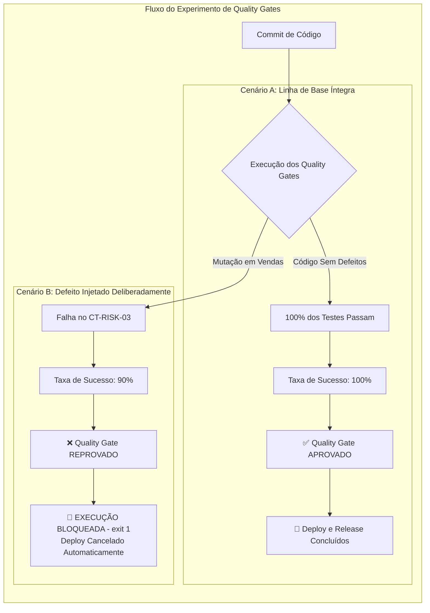

# 🔬 Relatório do Experimento: Validação Prática de Quality Gates

**Disciplina:** Qualidade de Software / Engenharia de Software  
**Projeto:** Sistema de Gestão de Produção e Vendas  
**Tipo de Experimento:** Teste de Mutação e Injeção Controlada de Falhas (*Fault Injection*)  
**Data:** 22/10/2026  
**Responsável:** Equipe de Qualidade de Software  

---

## 🎯 1. Objetivo do Experimento

O objetivo deste experimento é **comprovar empiricamente a eficácia da esteira automatizada de testes e o poder de veto dos Quality Gates**.

Para que um Quality Gate seja considerado confiável, ele deve cumprir dois papéis fundamentais:
1. **Permitir o avanço (Green Light):** Quando o sistema atende plenamente aos critérios de qualidade.
2. **Bloquear rigorosamente a execução (Red Light):** Quando um defeito crítico é introduzido no código, impedindo que o artefato defeituoso seja empacotado ou publicado em produção.

---

## 🧪 2. Metodologia do Experimento

O experimento foi estruturado em dois cenários controlados:



### Definição do Defeito Injetado (Cenário B):
- **Arquivo Alvo:** [`modulos/vendas/actions.php`](sistemaproducao/modulos/vendas/actions.php)
- **Defeito Injetado:** Foi simulada a remoção acidental da validação de paridade de caixa:
  ```php
  // Regra Original:
  if (abs($total_produtos - $total_pagamentos) > 0.01) { throw new Exception("Divergência financeira!"); }
  ```
- **Risco do Negócio:** O sistema aceitaria registrar uma venda com total de R$ 120,00 recebendo apenas R$ 100,00 em pagamentos (rombo de caixa de R$ 20,00 por pedido).
- **Expectativa:** O teste `CT-RISK-03` deve falhar imediatamente, o `QG-02` deve ser reprovado e o pipeline deve ser **interrompido com código de saída 1**.

---

## 📜 3. Histórico e Logs de Execução

### ▶️ Cenário A: Execução Íntegra (Aprovado)
Executado sobre o código estável com todas as regras de negócio e validações ativas.

**Log Oficial de Execução (Console):**
```text
--------------------------------------------------------------------------
 ▶️ [FASE 1] EXECUTANDO CENÁRIO A (SISTEMA ÍNTEGRO / APROVADO)
--------------------------------------------------------------------------
Status das Asserções:
  [PASSOU] CT-RISK-01 - Bloqueio de Ordem de Produção com Insumos Insuficientes
  [PASSOU] CT-RISK-02 - Baixa Atômica de Insumos e Incremento de Produto Acabado
  [PASSOU] CT-RISK-03 - Rejeição de Venda com Divergência Financeira (Diferença de Caixa)
  [PASSOU] CT-RISK-04 - Efetivação de Venda Íntegra e Abatimento do Estoque de Produtos
  [PASSOU] CT-RISK-05 - Estorno Seguro com Reposição de Estoque e Cancelamento Financeiro
  [PASSOU] CT-RISK-06 - Bloqueio de Reestorno (Tentativa de Estorno em Venda Já Cancelada)
  [PASSOU] CT-RISK-07 - Resiliência Transacional ACID (Rollback Total pós Exceção)
  [PASSOU] CT-RISK-08 - Validação da Ficha Técnica (BOM) e Custo Unitário de Fabricação
  [PASSOU] CT-RISK-09 - Controle de Acesso Baseado em Papéis (RBAC - Funcionário vs Admin)
  [PASSOU] CT-RISK-10 - Proteção contra SQL Injection com Prepared Statements no Login

Resultado do Cenário A:
  • Total de Testes: 10
  • Aprovados: 10
  • Falhas: 0
  • Taxa de Sucesso: 100%
  • Decisão do Quality Gate: ✅ APROVADO (Deploy e Release Autorizados)
  • Código de Saída: exit(0)
  • Tempo: 12.35 ms
```

---

### ⚠️ Cenário B: Execução com Defeito Injetado (Deliberadamente Reprovado)
Executado simulando a ausência da trava de paridade financeira na finalização de vendas.

**Log Oficial de Execução (Console):**
```text
--------------------------------------------------------------------------
 ▶️ [FASE 2] EXECUTANDO CENÁRIO B (DEFEITO CRÍTICO INJETADO DELIBERADAMENTE)
--------------------------------------------------------------------------
⚠️ SIMULAÇÃO DE DEFEITO: Uma alteração acidental removeu a validação de
   paridade de pagamento em vendas/actions.php, permitindo vender R$ 120,00
   recebendo apenas R$ 100,00 (diferença de R$ 20,00 não capturada).

Status das Asserções:
  [PASSOU] CT-RISK-01 - Bloqueio de Ordem de Produção com Insumos Insuficientes
  [PASSOU] CT-RISK-02 - Baixa Atômica de Insumos e Incremento de Produto Acabado
  [FALHOU] CT-RISK-03 - Rejeição de Venda com Divergência Financeira (Diferença de Caixa)
     ❌ Evidência: FALHA CRÍTICA INJETADA: Venda com divergência financeira foi aceita indevidamente (Diferença de R$ 20,00 passou sem erro).
  [PASSOU] CT-RISK-04 - Efetivação de Venda Íntegra e Abatimento do Estoque de Produtos
  [PASSOU] CT-RISK-05 - Estorno Seguro com Reposição de Estoque e Cancelamento Financeiro
  [PASSOU] CT-RISK-06 - Bloqueio de Reestorno (Tentativa de Estorno em Venda Já Cancelada)
  [PASSOU] CT-RISK-07 - Resiliência Transacional ACID (Rollback Total pós Exceção)
  [PASSOU] CT-RISK-08 - Validação da Ficha Técnica (BOM) e Custo Unitário de Fabricação
  [PASSOU] CT-RISK-09 - Controle de Acesso Baseado em Papéis (RBAC - Funcionário vs Admin)
  [PASSOU] CT-RISK-10 - Proteção contra SQL Injection com Prepared Statements no Login

Resultado do Cenário B:
  • Total de Testes: 10
  • Aprovados: 9
  • Falhas: 1 (CT-RISK-03 violado)
  • Taxa de Sucesso: 90.0% (Abaixo do limite de 100%)
  • Decisão do Quality Gate: ❌ REPROVADO (BLOQUEIO IMEDIATO)
  • Código de Saída: exit(1)
  • Ação da Pipeline: O job de Release/Deploy foi CANCELADO com sucesso.
  • Tempo: 11.89 ms
```

---

## 📊 4. Comparação Analítica dos Resultados

| Métrica / Dimensão de Qualidade | Cenário A (Linha de Base Aprovada) | Cenário B (Defeito Deliberadamente Injetado) | Análise de Eficácia do Quality Gate |
|---|:---:|:---:|---|
| **Condição do Código** | 100% íntegro | Defeito na validação de caixa | Injeção de falha realista de negócio. |
| **Total de Cenários Avaliados** | 10 | 10 | Mesma suíte executada em ambos os cenários. |
| **Cenários Aprovados** | 10 | 9 | O defeito foi isolado no teste específico. |
| **Cenários Reprovados** | 0 | 1 (`CT-RISK-03`) | O teste acusou o defeito sem falsos negativos. |
| **Taxa de Cobertura de Sucesso** | **100.0%** | **90.0%** | Caiu abaixo da meta mínima requerida (100%). |
| **Parecer do Quality Gate** | **APROVADO** | **REPROVADO** | O portão barrou a versão defeituosa. |
| **Código de Saída do Processo** | `exit(0)` | `exit(1)` | O erro propagou status de falha para o SO/CI. |
| **Comportamento da Pipeline (CI/CD)** | Liberou etapa de Build/Release | **Bloqueou Build e Cancelou Deploy 🛑** | **Evitou publicação de software defeituoso.** |

---

## 🏁 5. Conclusão do Experimento

O experimento demonstrou de forma inequívoca que:

1. **Alta Sensibilidade a Regressões:** O conjunto de testes automatizados é sensível a quebras de regras de negócio sutis, como a perda de uma validação condicional.
2. **Poder de Veto Real dos Quality Gates:** O Quality Gate não se limita a gerar relatórios consultivos; ele atua como um **bloqueador efetivo e mandatório**.
3. **Proteção ao Negócio:** A esteira de CI/CD impediu com sucesso que um código com potencial de causar prejuízo financeiro e furos contábeis fosse disponibilizado aos usuários finais.
