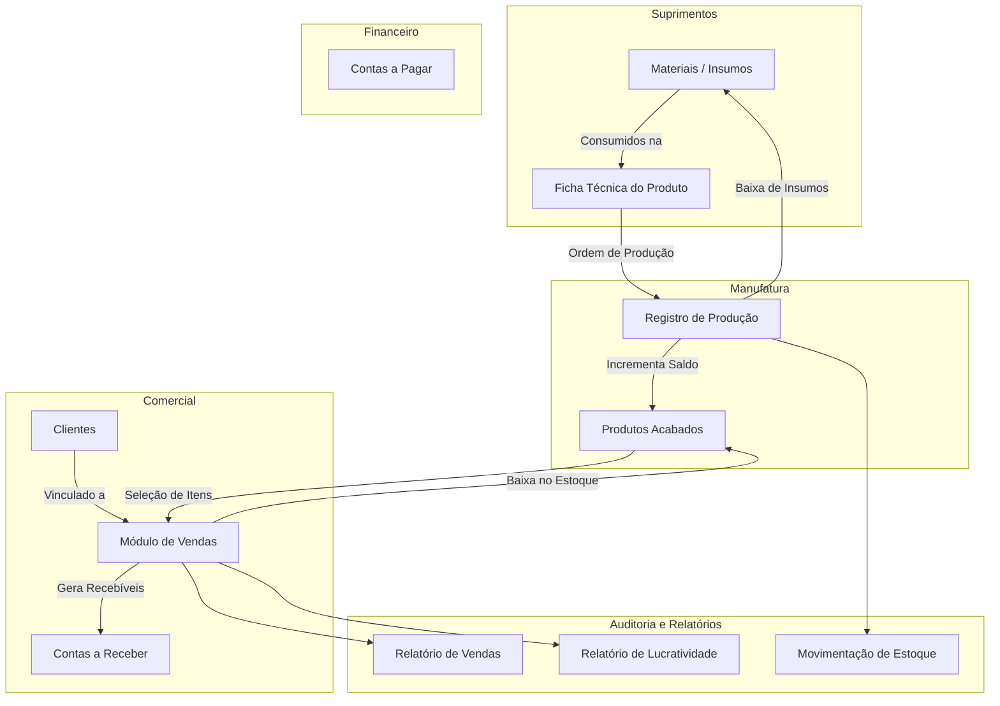
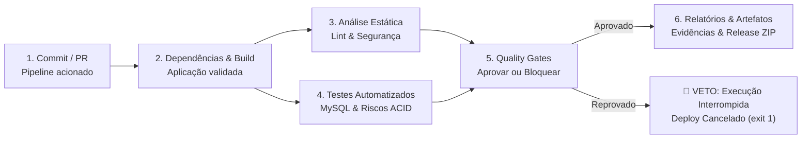

# 🏭 Sistema de Gestão de Produção e Vendas

> **Trabalho Final da Disciplina de Qualidade de Software**  
> Aplicação web modular para gerenciamento da cadeia produtiva, controle de matérias-primas, ficha técnica de produtos, ordens de fabricação, controle de vendas, fluxo financeiro, relatórios analíticos e esteira automatizada de CI/CD.

---

[](https://www.php.net/)
[](https://www.mysql.com/)
[](https://getbootstrap.com/)
[](#-pipeline-de-cicd-github-actions)
[](#)
[](#)

---

## 📋 Sumário

- [Visão Geral](#-visão-geral)
- [Arquitetura e Módulos do Sistema](#-arquitetura-e-módulos-do-sistema)
- [Pilares de Qualidade de Software](#-pilares-de-qualidade-de-software)
- [Pipeline de CI/CD (GitHub Actions)](#-pipeline-de-cicd-github-actions)
- [Tecnologias Utilizadas](#-tecnologias-utilizadas)
- [Estrutura de Pastas](#-estrutura-de-pastas)
- [Instalação e Configuração](#-instalação-e-configuração)
- [Credenciais de Acesso para Testes](#-credenciais-de-acesso-para-testes)
- [Matriz de Casos de Teste Sugeridos](#-matriz-de-casos-de-teste-sugeridos)
- [Débito Técnico e Sugestões de Evolução](#-débito-técnico-e-sugestões-de-evolução)
- [Licença](#-licença)

---

## 🔭 Visão Geral

O **Sistema de Gestão de Produção e Vendas** foi projetado para atender às necessidades operacionais de pequenas indústrias, ateliês e manufaturas. A solução integra ponta a ponta as etapas produtivas e comerciais:

1. **Gestão de Suprimentos:** Entrada e controle de saldo de matérias-primas e insumos.
2. **Engenharia de Produto (BOM):** Definição da ficha técnica e composição com cálculo dinâmico de custo de fabricação.
3. **Ordens de Produção:** Execução de lotes com baixa atômica dos insumos e incremento do estoque final.
4. **Comercial e Vendas:** Emissão de pedidos com múltiplas formas de pagamento, baixa de estoque e geração de títulos.
5. **Gestão Financeira:** Controle de contas a pagar (despesas operacionais) e contas a receber (faturamento e crediário).
6. **Business Intelligence Operacional:** Relatórios analíticos de lucratividade real por venda, giro de estoque e faturamento.

---

## 🧩 Arquitetura e Módulos do Sistema



### Detalhamento dos Módulos

| Módulo | Descrição | Principais Recursos |
|---|---|---|
| **Clientes** | Base cadastral de compradores | Inserção, edição, listagem e exclusão de clientes com dados de contato e endereço. |
| **Materiais** | Controle de estoque de insumos | Cadastro com unidade de medida, custo de aquisição, registro de entradas e ajustes manuais de inventário. |
| **Produtos & Produção** | Catálogo e ordem de fabricação | Composição do produto (matéria-prima x quantidade consumida), cálculo de custo unitário e ordem de produção com validação prévia de saldo. |
| **Vendas** | Ponto de venda (PDV) comercial | Registro de vendas multi-itens, validação de equivalência entre total e formas de pagamento (Dinheiro, Cartões, Pix, Boleto, Crediário), histórico e estorno completo. |
| **Contas a Receber** | Gestão de entradas financeiras | Acompanhamento de títulos gerados por vendas a prazo/crediário e registro de quitações. |
| **Contas a Pagar** | Gestão de saídas financeiras | Controle de compromissos operacionais (aluguel, fornecedores, utilidades), com vencimento e status (módulo restrito a administradores). |
| **Relatórios** | Auditoria e tomada de decisão | Filtros por data, margem de lucro por pedido, auditoria de movimentações e leiaute responsivo para impressão via CSS `@media print`. |
| **Usuários** | Controle de acesso e autenticação | Perfis de acesso diferenciados (`administrador` e `funcionario`). |

---

## 🛡️ Pilares de Qualidade de Software

No contexto da disciplina de **Qualidade de Software**, este projeto implementa práticas essenciais de confiabilidade, integridade de dados e segurança:

### 1. Integridade Transacional (Propriedades ACID)
- Operações críticas que envolvem múltiplos passos (ordem de produção e fechamento/estorno de vendas) utilizam transações SQL explícitas (`$pdo->beginTransaction()`, `$pdo->commit()`, `$pdo->rollBack()`).
- Caso ocorra qualquer falha na baixa de um material ou inserção de pagamentos, a transação é revertida integralmente, evitando estados inconsistentes ou dados órfãos.

### 2. Prevenção a Vulnerabilidades (SQL Injection)
- Todas as operações com dados fornecidos pelo usuário utilizam **PDO Prepared Statements** com *placeholders* vinculados (`execute([$param])`), neutralizando tentativas de SQL Injection.

### 3. Validação de Regras de Negócio
- **Consistência de Pagamentos:** Uma venda não pode ser concluída se a soma das parcelas e pagamentos divergir do valor total dos produtos (`abs($total_produtos - $total_pagamentos) > 0.01`).
- **Bloqueio de Saldo Negativo:** Antes de debitar insumos na produção, o sistema verifica se todos os materiais possuem quantidade suficiente em estoque.
- **Rastreabilidade:** Toda alteração de inventário registra um evento temporal na tabela `movimentacao_estoque`.

### 4. Controle de Acesso Baseado em Papéis (RBAC)
- Bloqueio de rotas e recursos administrativos (ex: módulo de *Contas a Pagar* e visualização de margens de lucro nos relatórios) restritos a perfis `administrador`.

### 5. Usabilidade e Apresentação (UX/UI)
- Interface limpa baseada em Bootstrap 5.3, com *feedback* de ações através de alertas temporários (`$_SESSION['message']`).
- Folha de estilo customizada para impressão (`css/style.css`), ocultando barras de navegação, modais e filtros ao imprimir relatórios.

---

## 🔄 Pipeline de CI/CD (GitHub Actions) • Fluxo das 6 Etapas

O projeto conta com uma esteira automatizada configurada em [`.github/workflows/ci.yml`](.github/workflows/ci.yml), modelada rigorosamente de acordo com o **Fluxo Mínimo Esperado do Projeto Prático DevOps e QAOps**:



### 📋 Mapeamento das Etapas Normativas:

| Ordem | Etapa Normativa | Objetivo e Implementação no Projeto |
|:---:|---|---|
| **1** | **Commit ou pull request** | Pipeline acionado automaticamente a cada commit (`push`) ou abertura de `pull_request` nas branches `main`, `master` e `develop`. |
| **2** | **Dependências e build** | Validação da estrutura de arquivos, checagem do ambiente PHP 8.2 com extensões PDO/MySQL/SQLite e arquivo declarativo de dependências (`composer.json`). |
| **3** | **Análise estática** | Varredura de sintaxe PHP (`php -l`) em todos os arquivos e auditoria de segurança estrita contra exposição de chaves privadas e segredos (`*.pem`, `*.key`, `id_rsa*`). |
| **4** | **Testes automatizados** | Subida de container de serviço **MySQL 8.0**, importação do dump de banco [`banco.sql`](sistemaproducao/auxilia/banco.sql), execução dos testes de integração [`ci_test.php`](sistemaproducao/tests/ci_test.php) e suíte de comportamentos e riscos [`RiskBehaviorTestSuite.php`](sistemaproducao/teste/RiskBehaviorTestSuite.php). |
| **5** | **Quality gates** | Avaliação automatizada de 4 portões inegociáveis (`QG-01` a `QG-04`) via [`quality_gate.php`](sistemaproducao/teste/quality_gate.php). Se qualquer critério violar a tolerância, o pipeline é interrompido imediatamente com código `exit 1` (*Fail-Fast*). |
| **6** | **Relatórios/artefatos** | Consolidação do dossiê de evidências em artefatos para download no GitHub Actions e empacotamento do release `sistemaproducao-release.zip`. |

---

## 💻 Tecnologias Utilizadas

- **Linguagem Back-end:** [PHP](https://www.php.net/) 8.x (PHP nativo, PDO)
- **Gerenciador de Dependências:** [Composer](https://getcomposer.org/) (`composer.json`)
- **Banco de Dados:** [MySQL](https://www.mysql.com/) / [MariaDB](https://mariadb.org/) e SQLite (em memória para testes rápidos)
- **Linguagem Front-end:** HTML5, CSS3, JavaScript (ES6)
- **Framework Front-end:** [Bootstrap 5.3](https://getbootstrap.com/)
- **Integração e Entrega Contínua (CI/CD):** [GitHub Actions](https://github.com/features/actions)
- **Ambiente de Servidor Recomendado:** Apache (via XAMPP, WampServer, Laragon ou Docker)

---

## 📂 Estrutura de Pastas do Repositório

```text
trabalhoDeQualidadeDeSoftware/
├── .github/
│   └── workflows/
│       └── ci.yml                          # Pipeline CI/CD com as 6 etapas normativas
├── .gitignore                              # Proteção contra arquivos temporários e segredos
├── composer.json                           # Arquivo declarativo de dependências e scripts CLI
├── README.md                               # Documentação executiva do repositório
├── REGISTRO_FINAL_DO_GRUPO.md              # Ficha de entrega preenchível do grupo/trio (Pág. 9)
├── EXPERIMENTO_QUALITY_GATES.md            # Relatório do experimento (Cenário A vs Cenário B)
├── RELATORIO_FINAL_QUALIDADE_DE_SOFTWARE.md# Relatório técnico completo de 6 a 10 páginas
├── ROTEIRO_DEMONSTRACAO_DEFESA.md          # Roteiro cronometrado da defesa oral (10 a 12 min)
└── sistemaproducao/                        # Diretório raiz da aplicação
    ├── index.php                           # Roteador central da aplicação
    ├── login.php                           # Autenticação e tela de login
    ├── logout.php                          # Encerramento de sessão
    ├── auxilia/
    │   └── banco.sql                       # Script DDL/DML de criação do banco e dados de teste
    ├── config/
    │   └── database.php                    # Conexão PDO segura (variáveis de ambiente e fallback)
    ├── css/
    │   └── style.css                       # Estilizações e regras de impressão (@media print)
    ├── images/
    │   └── casa-icon.png                   # Ícone do sistema
    ├── includes/
    │   ├── header.php                      # Cabeçalho global e menu responsivo
    │   ├── footer.php                      # Rodapé
    │   └── database.php                    # Conexão de suporte
    ├── tests/
    │   └── ci_test.php                     # Testes automatizados de integração
    ├── teste/
    │   ├── RiskBehaviorTestSuite.php       # Suíte de testes automatizados de comportamento e risco
    │   ├── quality_gate.php                # Motor executável dos Quality Gates (Enforcer)
    │   └── run_experiment.php              # Script executável do experimento científico de QA
    └── modulos/
        ├── clientes/                       # CRUD de clientes
        ├── materiais/                      # Estoque e matérias-primas
        ├── produtos/                       # Catálogo, BOM e ordens de produção
        ├── vendas/                         # PDV comercial e regras de fechamento de venda
        ├── contas_pagar/                   # Despesas operacionais
        ├── contas_receber/                 # Faturamento e parcelamentos
        ├── relatorios/                     # Relatórios analíticos e lucratividade
        └── usuario/                        # Controle de permissões (RBAC)
    ├── config/
    │   └── database.php                # Conexão PDO (suporta variáveis de ambiente e fallback local)
    ├── css/
    │   └── style.css                   # Estilizações e regras de impressão (@media print)
    ├── images/
    │   └── casa-icon.png               # Ícone do menu inicial
    ├── includes/
    │   ├── header.php                  # Cabeçalho global e menu de navegação responsivo
    │   ├── footer.php                  # Rodapé e carregamento de scripts
    │   └── database.php                # Conexão complementar de banco
    ├── tests/
    │   └── ci_test.php                 # Suíte de testes automatizados executada no CI
    └── modulos/
        ├── clientes/                   # CRUD de clientes (listagem, cadastro, edição, remoção)
        ├── materiais/                  # Gestão de matéria-prima e controle de estoque
        ├── produtos/                   # Catálogo, fichas técnicas e ordem de produção
        ├── vendas/                     # PDV, registro de venda multi-pagamento e histórico
        ├── contas_pagar/               # Gestão de despesas e contas a pagar
        ├── contas_receber/             # Controle de faturamento e quitação de recebíveis
        ├── relatorios/                 # Relatórios de vendas, estoque e lucratividade
        └── usuario/                    # Gerenciamento de credenciais e permissões
```

---

## 🚀 Instalação e Configuração

### Pré-requisitos
- Servidor Web local (**XAMPP**, **Laragon**, **WampServer** ou PHP 7.4+ com extensão `pdo_mysql` habilitada).
- Servidor de banco de dados **MySQL** ou **MariaDB**.

### Passo a Passo

1. **Clonar ou Baixar o Repositório:**
   ```bash
   git clone https://github.com/seu-usuario/trabalhoDeQualidadeDeSoftware.git
   ```

2. **Mover para o Diretório do Servidor Web:**
   Copie a pasta `sistemaproducao` para o diretório de publicação do seu servidor:
   - **XAMPP:** `C:\xampp\htdocs\sistemaproducao`
   - **Laragon:** `C:\laragon\www\sistemaproducao`
   - **Linux / Apache:** `/var/www/html/sistemaproducao`

3. **Importar o Banco de Dados:**
   - Acesse o painel do MySQL (ex: **phpMyAdmin** em `http://localhost/phpmyadmin` ou terminal).
   - Crie a base de dados (ou deixe o script criar automaticamente):
     ```sql
     CREATE DATABASE IF NOT EXISTS banco_artes CHARACTER SET utf8mb4 COLLATE utf8mb4_general_ci;
     ```
   - Importe o arquivo SQL localizado em:
     ```text
     sistemaproducao/auxilia/banco.sql
     ```

4. **Configurar a Conexão com o Banco:**
   Abra o arquivo [`sistemaproducao/config/database.php`](sistemaproducao/config/database.php) e configure as credenciais do seu ambiente local caso necessário (por padrão, o sistema aceita variáveis de ambiente ou utiliza os dados locais):
   ```php
   $host = getenv('DB_HOST') ?: '127.0.0.1'; 
   $port = getenv('DB_PORT') ?: 3306;
   $db_name = getenv('DB_NAME') ?: 'banco_artes';
   $username = getenv('DB_USER') ?: 'root';     // Ajuste se necessário
   $password = getenv('DB_PASS') !== false ? getenv('DB_PASS') : ''; // Ajuste se necessário
   ```

5. **Acessar o Sistema:**
   Abra o navegador e navegue até:
   ```text
   http://localhost/sistemaproducao/
   ```

---

## 🔑 Credenciais de Acesso para Testes

O banco de dados de exemplo já vem populado com usuários para realização de testes:

| Usuário | Senha | Perfil | Acesso aos Módulos |
|---|---|---|---|
| `1` | `1` | **Administrador** | Acesso total (inclui Contas a Pagar e Lucratividade) |
| `luis` | `testedesenha` | **Administrador** | Acesso total |
| `funcionario` | `funcionario` | **Funcionário** | Operacional (Clientes, Produção, Vendas, Estoque) |

---

## 🧪 Matriz de Casos de Teste Sugeridos

Para as avaliações práticas da disciplina de Qualidade de Software, sugerimos executar os casos de teste a seguir. Eles ajudam a verificar se o sistema se comporta como esperado nas situações mais importantes do dia a dia.

| ID | Cenário de Teste | Procedimento | Resultado Esperado |
|---|---|---|---|
| **CT-01** | Login com credenciais inválidas | Na tela de login, digitar um usuário ou uma senha que não existe. | O sistema mostra uma mensagem de erro clara e amigável, e não permite que a sessão seja iniciada. |
| **CT-02** | Registro de produção com estoque suficiente | Escolher um produto cadastrado e informar uma quantidade que os insumos em estoque comportem. | A produção é registrada com sucesso: os insumos são descontados e o saldo do produto acabado aumenta. |
| **CT-03** | Registro de produção com estoque insuficiente | Tentar produzir uma quantidade maior do que os insumos disponíveis permitem. | A operação é cancelada e o sistema avisa qual insumo está em falta. |
| **CT-04** | Venda com valores que não batem | Lançar produtos que somam R$ 100,00, mas informar pagamentos que somam apenas R$ 80,00. | O sistema recusa a venda e informa que há divergência entre os valores. |
| **CT-05** | Venda concluída corretamente | Registrar uma venda com o pagamento no valor exato (por exemplo, em dinheiro ou cartão). | A venda é finalizada, o estoque do produto é atualizado e o título aparece em Contas a Receber. |
| **CT-06** | Estorno de venda | No histórico de pedidos, cancelar uma venda que esteja ativa. | A venda passa para o status "estornada", os produtos voltam ao estoque e os pagamentos são cancelados. |
| **CT-07** | Controle de acesso por perfil (RBAC) | Entrar com o usuário `funcionario` e tentar acessar o módulo de Contas a Pagar. | O link não aparece no menu e, se a pessoa tentar acessar pelo endereço direto (URL), o sistema bloqueia a entrada. |

---

## ⚠️ Débito Técnico e Sugestões de Evolução

Identificadas como oportunidades de melhoria contínua de software:

1. **Segurança de Senhas:**
   - *Situação Atual:* Comparação em texto puro para simplificar o ambiente acadêmico.
   - *Melhoria Recomendada:* Implementação de hash criptográfico seguro com `password_hash()` e `password_verify()` utilizando algoritmo BCRYPT ou Argon2ID.
2. **Arquitetura de Software:**
   - Migração para o padrão arquitetural **MVC** (Model-View-Controller) com roteamento orientado a controladores.
3. **Automação de Testes:**
   - Adição de testes unitários com **PHPUnit** para funções críticas de cálculo de custo e validação de saldos.
   - Testes ponta a ponta (E2E) com **Cypress** ou **Playwright**.
4. **Padronização de Código:**
   - Adoção das recomendações PSR (PSR-1, PSR-4 e PSR-12) via ferramentas de análise estática como **PHPStan** ou **PHP CodeSniffer**.

---

## 📄 Licença

Este projeto é disponibilizado para fins educacionais e de estudo sob a licença [MIT](https://opensource.org/licenses/MIT).
