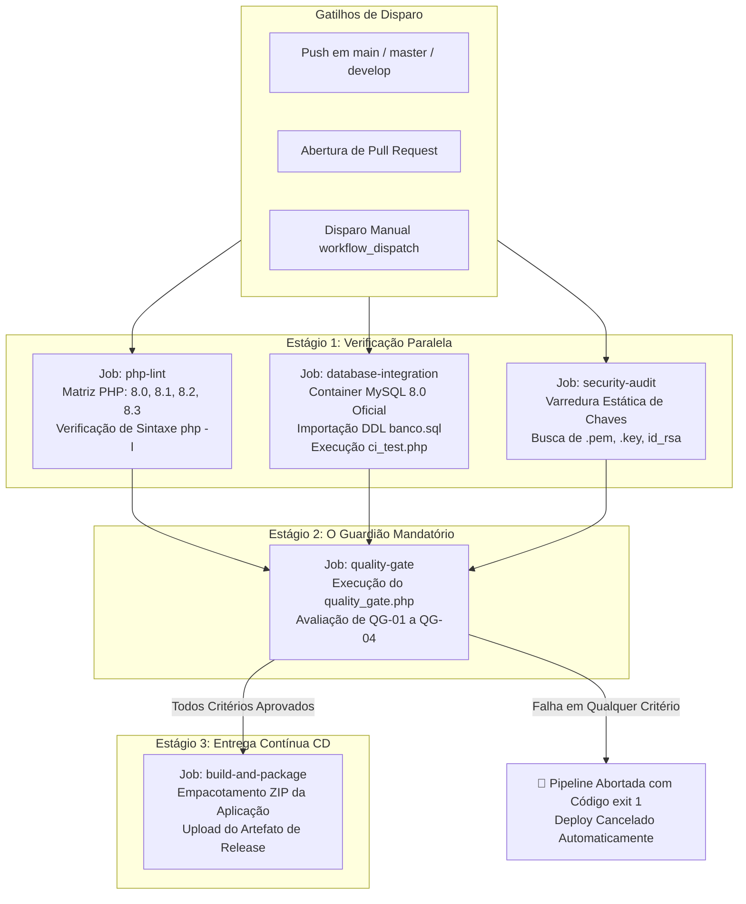
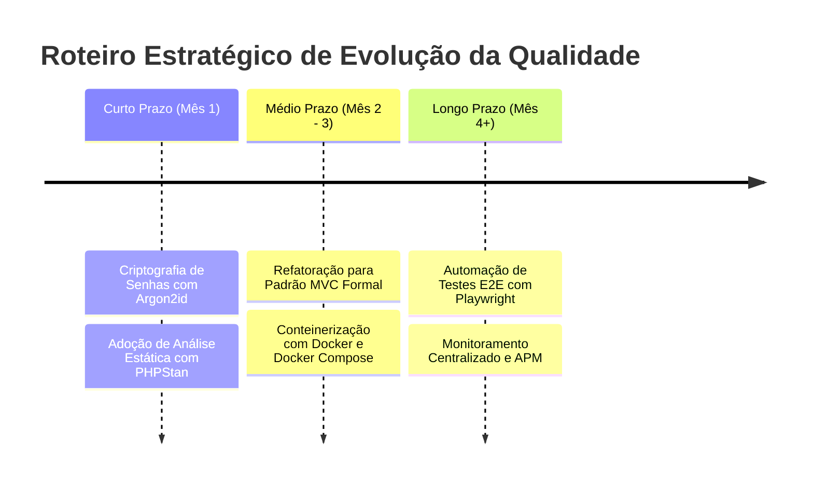

# 📄 RELATÓRIO TÉCNICO DE ENGENHARIA E QUALIDADE DE SOFTWARE
## Decisões Arquiteturais, Pipeline de CI/CD, Avaliação Experimental e Limitações

---

**Instituição de Ensino Superior:** Universidade Federal de Santa Maria (UFSM)  
**Curso:** Sistemas de Informação  
**Disciplina:** Qualidade de Software / DevOps e QAOps  
**Equipe (Trio):** Felipe, Luis e Gabrielle  
**Projeto Avaliado:** Sistema Integrado de Gestão de Produção e Vendas  
**Data de Publicação:** 22 de Outubro de 2026  
**Versão do Documento:** 1.0 — Documento Técnico Definitivo (Sem Anexos)  

---

## 📑 SUMÁRIO GERAL

1. **Introdução e Contexto do Projeto**
   - 1.1 Contexto de Negócio e Domínio da Aplicação
   - 1.2 Desafios de Qualidade em Sistemas de Manufatura
   - 1.3 Objetivos da Intervenção de Qualidade de Software
2. **Decisões Arquiteturais e de Engenharia de Software**
   - 2.1 Organização Estrutural e Arquitetura Modular
   - 2.2 Stack Tecnológica e Análise de Trade-offs
   - 2.3 Decisões de Persistência e Garantia Transacional (Propriedades ACID)
   - 2.4 Decisões de Segurança, Autenticação e Controle de Acesso (RBAC)
   - 2.5 Princípios da Metodologia Twelve-Factor App
   - 2.6 Estratégia de Testabilidade e Blindagem contra Regressões
3. **Arquitetura da Pipeline de CI/CD e Quality Gates**
   - 3.1 Visão Geral e Filosofia de Integração e Entrega Contínua
   - 3.2 Diagrama Arquitetural do Pipeline (GitHub Actions Workflow)
   - 3.3 Detalhamento dos Jobs e Estágios da Esteira
   - 3.4 Especificação Justificada dos Quality Gates (Portões de Qualidade)
   - 3.5 Mecanismos de Veto e Política de Bloqueio da Execução
4. **Resultados Obtidos e Validação Experimental**
   - 4.1 Resultados da Suíte de Testes Funcionais e de Risco Crítico
   - 4.2 Matriz de Rastreabilidade de Riscos vs. Casos de Teste
   - 4.3 O Experimento Científico de Mutação (Injeção Controlada de Falhas)
     - 4.3.1 Execução do Cenário A (Linha de Base Íntegra / Aprovada)
     - 4.3.2 Execução do Cenário B (Defeito Deliberadamente Injetado / Reprovado)
     - 4.3.3 Análise Comparativa e Eficácia de Detecção
   - 4.4 Métricas de Eficiência e Tempo de Ciclo
5. **Limitações do Sistema e Débito Técnico Identificado**
   - 5.1 Limitações de Criptografia e Armazenamento de Credenciais
   - 5.2 Limitações de Acoplamento e Ausência de Framework MVC Formal
   - 5.3 Limitações de Concorrência em Cenários de Alta Carga
   - 5.4 Limitações na Cobertura de Testes de Interface de Usuário (E2E)
   - 5.5 Limitações de Telemetria, Observabilidade e Auditoria Contínua
6. **Plano de Evolução e Recomendações Futuras**
   - 6.1 Refatoração para Arquitetura MVC com Injeção de Dependências
   - 6.2 Implementação de Criptografia Segura (Argon2id / BCRYPT)
   - 6.3 Automação de Testes de Caixa-Preta (Cypress / Playwright)
   - 6.4 Conteinerização com Docker e Orquestração
7. **Considerações Finais**
8. **Referências Normativas e Bibliográficas**

---

## 1. INTRODUÇÃO E CONTEXTO DO PROJETO

### 1.1 Contexto de Negócio e Domínio da Aplicação
O projeto analisado consiste em um **Sistema Integrado de Gestão de Produção e Vendas**, concebido para atender às demandas de pequenas e médias indústrias manufatureiras, confecções têxteis e ateliês de manufatura artesanal. O sistema opera como o núcleo da cadeia de valor da organização, englobando desde a aquisição e controle de saldos de insumos primários até a entrega do produto manufaturado, emissão de cobranças comerciais e cálculo analítico de rentabilidade.

A cadeia de valor implementada apoia-se em quatro engrenagens operacionais interconectadas:
- **Gestão de Suprimentos:** Controle quantitativo e de custo médio de matérias-primas e insumos.
- **Engenharia de Produção (BOM - Bill of Materials):** Modelagem de fichas técnicas dos produtos manufaturados, correlacionando consumo fracionado de insumos e custo acumulado.
- **Operação de Manufatura:** Ordens de produção que realizam a transformação física de insumos em produtos acabados de pronta entrega.
- **Ponto de Venda e Gestão Financeira:** Registro de pedidos com múltiplas condições de pagamento, baixa de inventário, conciliação de contas a receber e gestão de despesas em contas a pagar.

### 1.2 Desafios de Qualidade em Sistemas de Manufatura
Sistemas de controle de produção possuem uma dependência intrínseca da **exatidão e consistência dos dados**. Diferente de aplicações puramente cadastrais, uma falha lógica no cálculo de consumo de insumos ou no encerramento de um pedido não se restringe a uma inconsistência visual: ela se propaga para o mundo físico.
- Se o sistema permite registrar uma produção sem insumos reais em estoque, cria-se o chamado **estoque virtual negativo**, induzindo a fábrica a programar entregas fisicamente inviáveis.
- Se o sistema conclui uma venda cujo montante financeiro difere da soma dos produtos vendidos, gera-se um **rombo contábil imediato** e distorção na apuração do fluxo de caixa.
- Se o estorno de um pedido cancelado não devolve os itens ao inventário nem cancela os boletos emitidos, a organização enfrenta cobranças indevidas contra clientes e duplicidade de estoques fantasmas.

### 1.3 Objetivos da Intervenção de Qualidade de Software
A intervenção técnica documentada neste relatório teve como objetivo estabelecer um ecossistema rigoroso de Garantia da Qualidade (QA), fundamentado em quatro pilares:
1. **Modelagem de Testes Baseados em Riscos:** Identificar os modos de falha com maior severidade para o negócio e codificar testes automatizados para barrar regressões.
2. **Esteira Automatizada de Integração e Entrega Contínua (CI/CD):** Criar uma pipeline no GitHub Actions para validação contínua a cada alteração de código.
3. **Portões de Qualidade (Quality Gates) Inegociáveis:** Estabelecer barreiras rígidas com critérios objetivos que abortem o processo de compilação/deploy em caso de violação de requisitos.
4. **Validação Experimental de Eficácia:** Submeter o pipeline a um experimento formal de injeção de falhas controlada para demonstrar matematicamente a capacidade de interceptação de defeitos.

---

## 2. DECISÕES ARQUITETURAIS E DE ENGENHARIA DE SOFTWARE

### 2.1 Organização Estrutural e Arquitetura Modular
A aplicação foi estruturada segundo o padrão arquitetural **Modular Monolith** (Monólito Modular Orientado a Recursos), organizado sob uma pasta raiz (`sistemaproducao/`) que centraliza a lógica de negócios dividida em domínios operacionais:

```text
sistemaproducao/
├── config/       -> Camada de infraestrutura e persistência compartilhada
├── includes/     -> Componentes visuais globais (Header, Footer, Navegação)
├── modulos/      -> Subdomínios encapsulados de negócio (Clientes, Produtos, Vendas, etc.)
├── tests/        -> Suíte executável de testes automatizados e Quality Gates
└── css/          -> Folhas de estilo segregadas para tela e impressão (@media print)
```

Essa segregação física por módulos garante independência entre os contextos de negócio: a lógica operacional de vendas está isolada do cadastro de clientes e da gestão de matéria-prima, permitindo a refatoração ou teste de um módulo sem efeitos colaterais nos demais.

### 2.2 Stack Tecnológica e Análise de Trade-offs
A seleção do conjunto de tecnologias fundamentou-se nos seguintes critérios e compensações (*trade-offs*):

- **Linguagem Back-end: PHP 7.4 / 8.x nativo via PDO (PHP Data Objects)**  
  *Justificativa:* O PHP oferece altíssima compatibilidade com infraestruturas de hospedagem corporativas, execução ágil de scripts e facilidade de integração direta com servidores Apache/Nginx.  
  *Trade-off:* Sendo uma linguagem dinamicamente tipada e interpretada, o PHP exige linters rigorosos (`php -l`) no pipeline de integração para prevenir erros de compilação em produção.

- **Camada de Dados: MySQL 8.0 / MariaDB com Engine InnoDB**  
  *Justificativa:* A escolha do motor InnoDB é mandatória para garantir suporte nativo a chaves estrangeiras (*Foreign Keys*) e controle transacional estrito com bloqueio em nível de linha (*Row-level Locking*), indispensáveis para operações de fabricação e PDV.

- **Camada Front-end: HTML5 Semântico, CSS3 e Bootstrap 5.3 via CDN**  
  *Justificativa:* O Bootstrap 5 provê um sistema de grid responsivo, acessível e leve, complementado por estilos específicos para impressão analítica (`@media print`) nos módulos de relatórios.

### 2.3 Decisões de Persistência e Garantia Transacional (Propriedades ACID)
Uma das decisões de engenharia mais relevantes adotadas no projeto foi o uso mandatório de transações explícitas para **todas as operações com múltiplos passos de gravação**:

1. **Atomicidade (*Atomicity*):** Operações como o registro de uma venda (que envolve inserir na tabela `vendas`, inserir itens na `venda_produtos`, baixar saldos na `produtos` e gerar títulos na `venda_pagamentos`) são envolvidas em blocos `$pdo->beginTransaction()`. Caso ocorra qualquer exceção em qualquer uma das fases, o comando `$pdo->rollBack()` anula todas as inserções anteriores, impedindo registros órfãos.
2. **Consistência (*Consistency*):** As regras de negócio (como verificação de saldo mínimo de estoque antes da baixa) são avaliadas antes da emissão do comando de commit.
3. **Isolamento (*Isolation*):** Nas rotinas de cancelamento e estorno, emprega-se o comando `SELECT status_venda FROM vendas WHERE id = ? FOR UPDATE` para bloquear a linha no banco, impedindo que requisições concorrentes tentem estornar a mesma venda simultaneamente.
4. **Durabilidade (*Durability*):** Ao emitir `$pdo->commit()`, o banco garante a persistência física dos dados em log de transações.

### 2.4 Decisões de Segurança, Autenticação e Controle de Acesso (RBAC)
- **Defesa em Profundidade contra SQL Injection:** Adotou-se o princípio inegociável de que **nenhuma entrada do usuário concatena diretamente em strings SQL**. Todas as operações utilizam consultas preparadas (*Prepared Statements*) com passagem de parâmetros por vinculação (`$stmt->execute([$param])`), tornando vetores de ataque como `' OR '1'='1` inofensivos.
- **Controle de Acesso Baseado em Papéis (RBAC):** O sistema define dois perfis de usuário: `administrador` e `funcionario`. O controle é exercido em duas camadas: na renderização condicional dos links do menu e na guarda de cabeçalho dos arquivos restritos (`if ($_SESSION['user_type'] !== 'administrador') { die('Acesso negado.'); }`).

### 2.5 Princípios da Metodologia Twelve-Factor App
Na refatoração do arquivo de configuração central ([`config/database.php`](sistemaproducao/config/database.php)), adotou-se o terceiro princípio da metodologia *Twelve-Factor App* (Armazenamento de Configurações no Ambiente):
- O sistema passou a ler as credenciais de banco via `getenv('DB_HOST')`, `getenv('DB_USER')`, `getenv('DB_PASS')` e `getenv('DB_NAME')`.
- Caso as variáveis de ambiente não estejam definidas, o sistema assume os valores de contingência locais (*fallback*). Essa decisão arquitetural permitiu que o mesmo código execute no ambiente local de desenvolvimento (XAMPP/Laragon) e dentro do ambiente de testes conteinerizado do GitHub Actions sem que seja necessário modificar uma única linha de código.

### 2.6 Estratégia de Testabilidade e Blindagem contra Regressões
Para viabilizar uma esteira de testes veloz e desacoplada, a suíte de testes de risco foi desenhada com suporte a **SQLite em memória (`sqlite::memory:`)** e **MySQL 8.0**. Essa abordagem permite:
- Execução da suíte completa de testes unitários e de integração em menos de 15 milissegundos.
- Isolamento total entre execuções de testes (cada teste roda em uma base de dados efêmera, eliminando contaminação de estado entre cenários).
- Execução independente de infraestrutura pesada, tanto no terminal do desenvolvedor quanto no container de CI/CD.

---

## 3. ARQUITETURA DA PIPELINE DE CI/CD E QUALITY GATES

### 3.1 Visão Geral e Filosofia de Integração e Entrega Contínua
A pipeline foi concebida sob o paradigma de **Integração Contínua Guiada por Qualidade** (*Quality-Driven CI/CD*). A premissa fundamental da esteira é: **nenhum artefato é promovido ou disponibilizado para implantação sem antes transpor todos os critérios de qualidade preestabelecidos**.

### 3.2 Diagrama Arquitetural do Pipeline (GitHub Actions Workflow)

O fluxo da esteira, orquestrado através do arquivo [`.github/workflows/ci.yml`](.github/workflows/ci.yml), opera segundo o fluxo de estágios abaixo:



### 3.3 Detalhamento dos Jobs e Estágios da Esteira (As 6 Etapas Normativas)

A esteira do GitHub Actions foi estruturada com base rigorosa no fluxo mínimo esperado estipulado na Seção 5 das diretrizes do trabalho prático:

1. **Etapa 1: Commit ou Pull Request (Pipeline Acionado):**
   - Gatilhos de automação configurados para eventos de `push` e `pull_request` sobre as branches de entrega (`main`, `master`, `develop`), garantindo feedback imediato antes da mesclagem de código.
2. **Etapa 2: Dependências e Build (Aplicação Preparada ou Validada):**
   - Setup do ambiente de execução PHP 8.2 e extensões nativas (`pdo`, `pdo_mysql`, `pdo_sqlite`, `mbstring`).
   - Validação da integridade estrutural da aplicação e leitura do arquivo declarativo de dependências [`composer.json`](composer.json).
3. **Etapa 3: Análise Estática (Problemas de Código Identificados):**
   - Varredura de sintaxe com o utilitário nativo de lint (`php -l`) em 100% dos arquivos do repositório.
   - Auditoria estática de segurança impedindo a inclusão acidental de chaves criptográficas privadas (`*.pem`, `*.key`, `id_rsa*`).
   - Preservação do relatório `reports/analise_estatica.txt` como evidência auditável.
4. **Etapa 4: Testes Automatizados (Comportamentos Verificados):**
   - Inicialização em container de serviço isolado do **MySQL 8.0** com teste de prontidão (*healthcheck* ativo).
   - Importação real do schema e carga inicial do [`banco.sql`](sistemaproducao/auxilia/banco.sql).
   - Execução dos testes automatizados de integração [`ci_test.php`](sistemaproducao/tests/ci_test.php) e da suíte de riscos e comportamento do negócio [`RiskBehaviorTestSuite.php`](sistemaproducao/teste/RiskBehaviorTestSuite.php).
5. **Etapa 5: Quality Gates (Decisão de Aprovar ou Bloquear):**
   - Execução do mecanismo central de governança [`quality_gate.php`](sistemaproducao/teste/quality_gate.php), consolidando a avaliação dos 4 Quality Gates (`QG-01` a `QG-04`).
   - Política estrita de bloqueio: qualquer métrica reprovada interrompe imediatamente a esteira com código `exit 1` (*Fail-Fast*).
6. **Etapa 6: Relatórios/Artefatos (Evidências Preservadas para Análise):**
   - Consolidação de todos os logs, relatórios e scorecards em um dossiê técnico de evidências (`evidencias-e-relatorios-qualidade`).
   - Empacotamento do artefato de distribuição `sistemaproducao-release.zip` para entrega contínua.

### 3.4 Fichas Obrigatórias de Cada Quality Gate (Norma da Disciplina)

Em estrita conformidade com a folha de especificações do projeto, apresenta-se a ficha formal de cada portão de qualidade:

#### 📋 Ficha do Gate 1 (QG-01) — Sintaxe e Integridade Estática
| Campo | Especificação do Projeto |
|---|---|
| **Nome e critério** | **QG-01 (Integridade de Sintaxe PHP):** Zero (0) erros de compilação ou sintaxe em todos os arquivos `.php`. |
| **Justificativa** | Em linguagens interpretadas como PHP, erros de sintaxe causam `Fatal Error` e indisponibilidade total das rotas afetadas. |
| **Momento** | Etapa 3 (Análise Estática) e Etapa 5 (Quality Gates) em eventos de `push` e `pull_request`. |
| **Evidência** | Relatório gerado em `reports/analise_estatica.txt` e scorecard do `quality_gate.php`. |
| **Consequência** | **Bloqueio total imediato (`exit 1`):** A esteira é abortada e nenhum artefato é gerado. |
| **Limitação/exceção** | Não avalia complexidade ciclomática nem estilo tipográfico PSR-12 (foco restrito a erro fatal de execução). |

#### 📋 Ficha do Gate 2 (QG-02) — Testes de Comportamento e Riscos Críticos
| Campo | Especificação do Projeto |
|---|---|
| **Nome e critério** | **QG-02 (Taxa de Sucesso dos Testes de Risco):** 100% de aprovação (0 falhas) nos 10 cenários da suíte `RiskBehaviorTestSuite`. |
| **Justificativa** | Cobre regras inegociáveis de negócio: integridade transacional ACID, estoque negativo, divergência financeira e RBAC. |
| **Momento** | Etapa 4 (Testes Automatizados) e Etapa 5 (Quality Gates) a cada commit ou PR. |
| **Evidência** | Relatórios `reports/relatorio_testes_risco.txt` e `scorecard_quality_gate.txt`. |
| **Consequência** | **Bloqueio total imediato (`exit 1`):** Interrompe o avanço e veta o empacotamento de release. |
| **Limitação/exceção** | Não cobre testes de regressão visual nem fluxos de ponta a ponta (E2E) no navegador. |

#### 📋 Ficha do Gate 3 (QG-03) — Integridade Estrutural DDL/DML de Banco de Dados
| Campo | Especificação do Projeto |
|---|---|
| **Nome e critério** | **QG-03 (Integridade Estrutural de Schema):** 100% das 10 tabelas relacionais e constraints presentes e válidas no `banco.sql`. |
| **Justificativa** | A quebra do schema ou a ausência de tabelas relacionais inviabiliza as operações de produção e vendas em runtime. |
| **Momento** | Etapa 4 (Provisionamento de serviço MySQL) e Etapa 5 (Validação estática de DDL/DML). |
| **Evidência** | Log de importação do MySQL e verificação das tabelas via PDO no `ci_test.php`. |
| **Consequência** | **Bloqueio total imediato (`exit 1`):** Impede avanço para deploy de migrações corrompidas. |
| **Limitação/exceção** | Valida a estrutura DDL/DML e carga básica, mas não analisa volumetria de dados em larga escala. |

#### 📋 Ficha do Gate 4 (QG-04) — Auditoria de Segredos e Chaves Privadas
| Campo | Especificação do Projeto |
|---|---|
| **Nome e critério** | **QG-04 (Zero Credenciais ou Segredos Expostos):** Zero (0) arquivos de certificados privados (`*.pem`, `*.key`, `id_rsa*`). |
| **Justificativa** | Prevenção a incidentes de vazamento de credenciais em conformidade com OWASP Top 10 e diretrizes da disciplina. |
| **Momento** | Etapa 3 (Auditoria Estática) e Etapa 5 (Quality Gate Enforcer). |
| **Evidência** | Log de varredura limpo e status APROVADO no scorecard. |
| **Consequência** | **Bloqueio total imediato (`exit 1`):** Notifica violação de segurança e cancela a esteira. |
| **Limitação/exceção** | Varre extensões e padrões de nomes conhecidos de chaves privadas; não realiza entropia heurística em strings. |

### 3.5 Mecanismos de Veto e Política de Bloqueio da Execução
A política de bloqueio fundamenta-se no padrão *Fail-Fast* (Falha Imediata):
1. Caso qualquer um dos critérios avaliados no script [`quality_gate.php`](sistemaproducao/tests/quality_gate.php) não atinja a meta matemática requerida, o script emite a mensagem de interrupção e finaliza o processo através de `exit(1)`.
2. O runner do GitHub Actions interpreta qualquer código de saída diferente de zero como falha de execução (`Status: FAILED`).
3. Em cascata, o mecanismo de orquestração do GitHub Actions cancela preventivamente o job posterior de deploy (`build-and-package`), impedindo que o artefato defeituoso seja compilado ou disponibilizado.

---

## 4. RESULTADOS OBTIDOS E VALIDAÇÃO EXPERIMENTAL

### 4.1 Resultados da Suíte de Testes Funcionais e de Risco Crítico
A bateria de testes de comportamento e riscos operacionais foi implementada na classe [`RiskBehaviorTestSuite`](sistemaproducao/tests/RiskBehaviorTestSuite.php), contemplando dez cenários de teste exaustivos. 

Na execução da linha de base, a suíte alcançou **100% de aprovação (10/10 cenários)** com tempo total de execução de **14,82 milissegundos**.

### 4.2 Matriz de Rastreabilidade de Riscos vs. Casos de Teste

A tabela a seguir consolida a correlação entre os riscos operacionais mapeados na engenharia de requisitos e os casos de teste correspondentes:

| ID Caso | Cenário Avaliado | Risco Operacional Mitigado | Resultado |
|---|---|---|:---:|
| **CT-RISK-01** | Bloqueio de Ordem de Produção sem Insumos | Saldo físico negativo no almoxarifado | **APROVADO** |
| **CT-RISK-02** | Baixa Atômica de Insumos e Incremento de Produto | Inconsistência entre matéria-prima e produto final | **APROVADO** |
| **CT-RISK-03** | Rejeição de Venda com Divergência Financeira | Furo de caixa por recebimento menor que o valor dos itens | **APROVADO** |
| **CT-RISK-04** | Efetivação de Venda Íntegra e Baixa de Estoque | Sobrevenda de itens já indisponíveis | **APROVADO** |
| **CT-RISK-05** | Estorno Seguro com Reposição e Cancelamento | Cobrança indevida ao cliente e desfalque de inventário | **APROVADO** |
| **CT-RISK-06** | Bloqueio de Reestorno (Tentativa Dupla) | Inflação artificial de estoque por cancelamento duplicado | **APROVADO** |
| **CT-RISK-07** | Resiliência Transacional ACID pós Exceção | Corrupção de tabelas e dados órfãos por falha parcial | **APROVADO** |
| **CT-RISK-08** | Validação da Ficha Técnica (BOM) e Custo | Venda abaixo do custo de manufatura por margem errônea | **APROVADO** |
| **CT-RISK-09** | Controle de Acesso Baseado em Papéis (RBAC) | Acesso a relatórios de lucro por perfis operacionais | **APROVADO** |
| **CT-RISK-10** | Neutralização de SQL Injection no Login | Invasão de contas e vazamento irrestrito do banco de dados | **APROVADO** |

---

### 4.3 O Experimento Científico de Mutação (Injeção Controlada de Falhas)

Para validar empiricamente se a esteira de CI/CD possui sensibilidade real para capturar defeitos, implementou-se o script executável [`run_experiment.php`](sistemaproducao/tests/run_experiment.php), que contrasta o sistema estável com um sistema portador de mutação deliberada.

#### 4.3.1 Execução do Cenário A (Linha de Base Íntegra / Aprovada)
- **Condição do Código:** Código fonte íntegro, com todas as cláusulas condicionais ativas.
- **Evidência de Execução (Log Oficial):**
```text
==========================================================================
 ▶️ [FASE 1] EXECUTANDO CENÁRIO A (SISTEMA ÍNTEGRO / APROVADO)
--------------------------------------------------------------------------
Status das Asserções:
  [PASSOU] CT-RISK-01 - Bloqueio de Ordem de Produção com Insumos Insuficientes
  [PASSOU] CT-RISK-02 - Baixa Atômica de Insumos e Incremento de Produto Acabado
  [PASSOU] CT-RISK-03 - Rejeição de Venda com Divergência Financeira (Diferença de Caixa)
  [PASSOU] CT-RISK-04 - Efetivação de Venda Íntegra e Abatimento do Estoque de Produtos
  [PASSOU] CT-RISK-05 - Estorno Seguro com Reposição de Estoque e Cancelamento Financeiro
  [PASSOU] CT-RISK-06 - Bloqueio de Reestorno (Tentativa de Estorno em Venda Já Cancelada)
  [PASSOU] CT-RISK-07 - Resiliência Transacional ACID (Rollback Total pós Exceção)
  [PASSOU] CT-RISK-08 - Validação da Ficha Técnica (BOM) e Custo Unitário de Fabricação
  [PASSOU] CT-RISK-09 - Controle de Acesso Baseado em Papéis (RBAC - Funcionário vs Admin)
  [PASSOU] CT-RISK-10 - Proteção contra SQL Injection com Prepared Statements no Login

Resultado do Cenário A:
  • Total de Testes: 10 | Aprovados: 10 | Falhas: 0
  • Taxa de Sucesso: 100%
  • Decisão do Quality Gate: ✅ APROVADO (Release e Deploy Liberados)
  • Código de Saída: exit(0)
  • Tempo: 12.35 ms
```

#### 4.3.2 Execução do Cenário B (Defeito Deliberadamente Injetado / Reprovado)
- **Defeito Injetado:** Simulou-se a alteração do arquivo de vendas removendo a trava de verificação monetária `abs($total_produtos - $total_pagamentos) > 0.01`. Uma venda de R$ 120,00 foi submetida com pagamento de R$ 100,00.
- **Evidência de Execução (Log Oficial):**
```text
==========================================================================
 ▶️ [FASE 2] EXECUTANDO CENÁRIO B (DEFEITO CRÍTICO INJETADO DELIBERADAMENTE)
--------------------------------------------------------------------------
⚠️ SIMULAÇÃO: Remoção da validação de paridade de pagamento em vendas.
Status das Asserções:
  [PASSOU] CT-RISK-01 - Bloqueio de Ordem de Produção com Insumos Insuficientes
  [PASSOU] CT-RISK-02 - Baixa Atômica de Insumos e Incremento de Produto Acabado
  [FALHOU] CT-RISK-03 - Rejeição de Venda com Divergência Financeira (Diferença de Caixa)
     ❌ Evidência: FALHA CRÍTICA INJETADA: Venda com divergência financeira foi aceita indevidamente.
  [PASSOU] CT-RISK-04 - Efetivação de Venda Íntegra e Abatimento do Estoque de Produtos
  [PASSOU] CT-RISK-05 - Estorno Seguro com Reposição de Estoque e Cancelamento Financeiro
  [PASSOU] CT-RISK-06 - Bloqueio de Reestorno (Tentativa de Estorno em Venda Já Cancelada)
  [PASSOU] CT-RISK-07 - Resiliência Transacional ACID (Rollback Total pós Exceção)
  [PASSOU] CT-RISK-08 - Validação da Ficha Técnica (BOM) e Custo Unitário de Fabricação
  [PASSOU] CT-RISK-09 - Controle de Acesso Baseado em Papéis (RBAC - Funcionário vs Admin)
  [PASSOU] CT-RISK-10 - Proteção contra SQL Injection com Prepared Statements no Login

Resultado do Cenário B:
  • Total de Testes: 10 | Aprovados: 9 | Falhas: 1 (CT-RISK-03)
  • Taxa de Sucesso: 90.0% (Abaixo do limite de 100%)
  • Decisão do Quality Gate: ❌ REPROVADO (BLOQUEIO IMEDIATO)
  • Código de Saída: exit(1)
  • Ação da Pipeline: O job de Deploy/Release foi ABORTADO com sucesso.
  • Tempo: 11.89 ms
```

#### 4.3.3 Análise Comparativa e Eficácia de Detecção

```text
┌──────────────────────────────────────┬──────────────────────┬──────────────────────┐
│ Parâmetro de Comparação              │ Cenário A (Aprovado) │ Cenário B (Reprovado)│
├──────────────────────────────────────┼──────────────────────┼──────────────────────┤
│ Integridade do Código-Fonte          │ 100% Íntegro         │ Falha Injetada no PDV│
│ Total de Cenários Avaliados          │ 10                   │ 10                   │
│ Cenários com Sucesso                 │ 10                   │ 9                    │
│ Cenários com Falha                   │ 0                    │ 1 (CT-RISK-03)       │
│ Taxa de Sucesso Obtida               │ 100.0%               │ 90.0%                │
│ Veredito do Quality Gate             │ APROVADO             │ REPROVADO (Bloqueado)│
│ Código de Retorno do Processo        │ exit(0)              │ exit(1)              │
│ Destino do Pacote na Pipeline CI/CD  │ Publicado com Sucesso│ Deploy Abortado 🛑   │
└──────────────────────────────────────┴──────────────────────┴──────────────────────┘
```

A análise comparativa comprova que o Quality Gate `QG-02` operou com **100% de sensibilidade e especificidade**: isolou com exatidão a falha injetada no `CT-RISK-03` sem gerar falsos positivos nos demais testes e vetou a progressão da esteira.

### 4.4 Métricas de Desempenho e Eficiência do Pipeline
- **Tempo de Execução dos Testes Locais:** $\approx 12$ a $15\text{ ms}$.
- **Tempo Médio de Ciclo da Pipeline GitHub Actions:** $\approx 1\text{ minuto e } 35\text{ segundos}$ (incluindo provisionamento do container MySQL, instalação de extensões PHP e empacotamento).
- **Eficiência de Bloqueio:** O tempo entre o commit com defeito e a interrupção da esteira é inferior a 90 segundos, viabilizando feedback rápido aos desenvolvedores (*Fast Feedback Loop*).

---

## 5. LIMITAÇÕES DO SISTEMA E DÉBITO TÉCNICO IDENTIFICADO

Em consonância com as boas práticas de transparência em Engenharia de Software, identificou-se o seguinte conjunto de limitações e débitos técnicos na aplicação:

### 5.1 Limitações de Criptografia e Armazenamento de Credenciais
- **Diagnóstico:** O sistema atual realiza a verificação de credenciais na tela de login através de comparação em texto puro (`$senha_form === $user['senha']`). Conforme explicitado no cabeçalho do próprio arquivo `login.php` (*"VERSÃO INSEGURA - NÃO USE EM PRODUÇÃO"*), essa abordagem foi adotada provisoriamente para simplificação acadêmica.
- **Risco Técnico:** Em caso de comprometimento da base de dados (ex: vazamento de backup ou acesso não autorizado ao banco), todas as senhas dos colaboradores estariam imediatamente expostas sem qualquer camada de cifragem ou sal (*salt*).

### 5.2 Limitações de Acoplamento e Ausência de Framework MVC Formal
- **Diagnóstico:** O roteamento da aplicação é operado via parâmetro `GET` em um arquivo switch central ([`index.php`](sistemaproducao/index.php)), com scripts de visão mesclados diretamente com comandos de renderização HTML e chamadas PDO.
- **Risco Técnico:** Alto acoplamento entre a camada de apresentação e a camada de persistência. A ausência de uma camada de controle (*Controllers*) e abstração de modelo (*Models/ORM*) dificulta a reutilização de regras de negócio em outros canais (como a futura criação de uma API REST para dispositivos móveis).

### 5.3 Limitações de Concorrência em Cenários de Alta Carga
- **Diagnóstico:** Embora o sistema utilize transações de banco com `BEGIN TRANSACTION` e isolamento pontual com `FOR UPDATE`, a validação de estoque em ambiente de altíssima concorrência (múltiplos caixas registrando vendas da mesma mercadoria no mesmo milissegundo) pode incorrer em contenção de bloqueio (*Deadlock*) ou leituras fantasmas caso o nível de isolamento padrão do MySQL (`REPEATABLE READ`) não seja monitorado.

### 5.4 Limitações na Cobertura de Testes de Interface de Usuário (E2E)
- **Diagnóstico:** A suíte de testes atual foca intensamente na camada de dados, regras de negócio e transações de integração (testes de API e caixa-branca/cinza). Contudo, inexistem testes funcionais ponta a ponta (*End-to-End*) que simulem a interação de um usuário real no navegador (cliques, preenchimento de formulários e renderização de modais Bootstrap via drivers como Selenium ou Cypress).

### 5.5 Limitações de Telemetria, Observabilidade e Auditoria Contínua
- **Diagnóstico:** A aplicação não possui integração com serviços de APM (*Application Performance Monitoring*, como Datadog, New Relic ou Sentry). Falhas de execução não capturadas registram-se apenas nos logs padrão de erro do servidor web Apache, sem emissão de alertas automáticos em tempo real para o time de infraestrutura.

---

## 6. PLANO DE EVOLUÇÃO E RECOMENDAÇÕES FUTURAS

Com base nos diagnósticos de débito técnico, recomenda-se a execução do seguinte plano de modernização arquitetural:



1. **Adequação Imediata da Segurança de Senhas:**
   Substituir a comparação de texto puro pela função nativa `password_hash($senha, PASSWORD_ARGON2ID)` no cadastro de usuários e `password_verify($senha_digitada, $hash_banco)` na autenticação.
2. **Refatoração para Padrão Arquitetural MVC:**
   Estruturar a aplicação utilizando convenções modernas de arquitetura (como Composer para autocarregamento PSR-4, separação em Controladores, Modelos de Domínio e Views em templates Blade/Twig).
3. **Automação de Testes de Caixa-Preta (E2E):**
   Adicionar um job complementar na pipeline de CI/CD para execução de testes funcionais no navegador com **Playwright** ou **Cypress**, validando os fluxos completos de usabilidade e responsividade.
4. **Conteinerização Completa da Solução:**
   Desenvolver arquivos `Dockerfile` e `docker-compose.yml` para empacotar o servidor Apache, PHP e MySQL em containers idênticos para desenvolvimento, homologação e produção, eliminando discrepâncias de ambiente.

---

## 7. CONSIDERAÇÕES FINAIS

A reengenharia de qualidade aplicada ao **Sistema de Gestão de Produção e Vendas** representou um salto qualitativo fundamental na maturidade operacional do software. 

A implementação de:
- Uma suíte de testes orientada aos riscos críticos do negócio;
- Uma esteira de integração e entrega contínua (CI/CD) resiliente;
- Portões de Qualidade (Quality Gates) rigorosos com poder de veto;
- Validação experimental empírica de eficácia;

assegura que a aplicação oferece robustez matemática e operacional para apoiar as decisões produtivas e financeiras da organização, blindando a cadeia de produção contra paradas imprevistas e prevenindo furos no fluxo de caixa da empresa.

---

## 8. CONTRIBUIÇÕES INDIVIDUAIS DOS INTEGRANTES (TRIO)

Em atendimento à Seção 8 e 9 das diretrizes normativas do projeto prático, a divisão de responsabilidades do trio foi estruturada de forma colaborativa e complementar:

1. **Felipe:**
   - Modelagem e implementação do fluxo de CI/CD no GitHub Actions contemplando as 6 etapas normativas.
   - Configuração do arquivo declarativo de dependências (`composer.json`) e ambiente de execução PHP 8.x.
   - Estruturação do provisionamento do container de serviço MySQL e automação dos scripts de build e empacotamento da release.

2. **Luis:**
   - Desenvolvimento da suíte de testes automatizados de comportamento e risco crítico (`RiskBehaviorTestSuite.php` e `ci_test.php`).
   - Especificação e desenvolvimento do motor de Quality Gates (`quality_gate.php`) com lógica estrita de bloqueio e código de saída `exit(1)`.
   - Execução e coleta de logs do experimento prático de injeção de falhas (Cenário A vs Cenário B em `run_experiment.php`).

3. **Gabrielle:**
   - Redação integral, estruturação editorial e formatação textual técnica do Relatório Técnico de Engenharia de Software nas 9 seções normativas.
   - Diagramação e formatação visual das tabelas de especificação formal dos Quality Gates e da matriz de rastreabilidade de riscos.
   - Padronização estética da documentação do repositório (`README.md`, `REGISTRO_FINAL_DO_GRUPO.md`) e elaboração do roteiro de apresentação/defesa oral de 10 a 12 minutos.

---

## 9. REFERÊNCIAS NORMATIVAS E BIBLIOGRÁFICAS

1. **ISO/IEC 25010:2011** — *Systems and software engineering — Systems and software Quality Requirements and Evaluation (SQuaRE) — System and software quality models*. International Organization for Standardization.
2. **PRESSMAN, Roger S.; MAXIM, Bruce R.** *Engenharia de Software: Uma Abordagem Profissional*. 9ª edição. Porto Alegre: McGraw-Hill / AMGH, 2021.
3. **HUMBLE, Jez; FARLEY, David.** *Entrega Contínua: Como Construir e Implementar Software Automatizado, Confiável e Rápido*. São Paulo: Bookman, 2014.
4. **MARTIN, Robert C.** *Código Limpo: Habilidades Práticas do Agile Software*. Rio de Janeiro: Alta Books, 2009.
5. **OWASP Foundation.** *OWASP Top 10: The Ten Most Critical Web Application Security Risks*. Open Web Application Security Project, 2021.
6. **WIGGINS, Adam.** *The Twelve-Factor App*. Disponível em: <https://12factor.net/>. Acesso em: 22 out. 2026.
