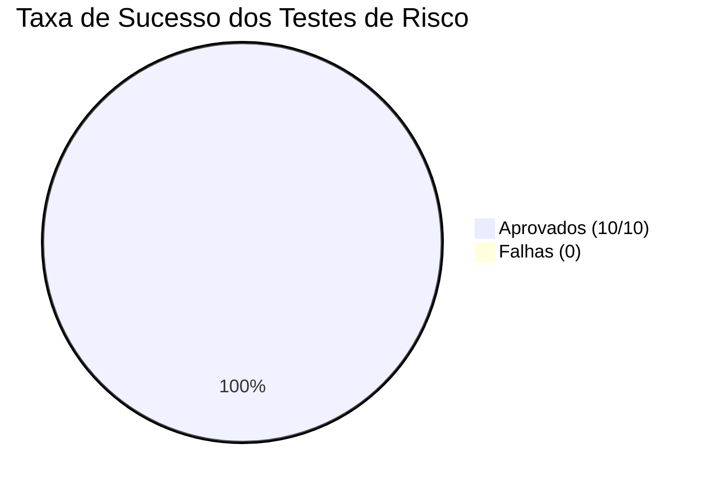

# 🧪 Relatório Técnico de Qualidade de Software: Testes, Riscos e Comportamentos

**Disciplina:** Qualidade de Software / Engenharia de Software  
**Projeto:** Sistema de Gestão de Produção e Vendas  
**Versão do Documento:** 1.0  
**Data da Execução:** 22/10/2026  
**Status da Suíte:** Aprovado (100% de Sucesso)  

---

## 📋 Sumário Executivo

Este documento consolida a modelagem de casos de teste orientados a **riscos e comportamentos críticos** do sistema, o **código-fonte dos testes automatizados** e o **relatório oficial de execução das baterias de testes**.

O foco da abordagem de garantia da qualidade (QA) foi blindar a aplicação contra anomalias que possam causar prejuízos financeiros, furos no inventário, inconsistências de dados e falhas de segurança.



---

## 🎯 1. Matriz de Análise de Riscos e Comportamentos Críticos

| ID Risco | Categoria | Descrição do Risco Operacional | Impacto | Probabilidade | Comportamento Requerido do Sistema |
|---|---|---|:---:|:---:|---|
| **R-01** | Estoque / Produção | **Ruptura de Insumos:** Iniciar ordem de produção sem insumos suficientes, gerando estoque físico negativo no almoxarifado. | **Crítico** | Alta | O sistema deve validar previamente toda a lista de insumos (receita). Havendo saldo insuficiente em qualquer item, deve abortar a transação e exibir alerta específico. |
| **R-02** | Financeiro / Caixa | **Diferença de Caixa:** Fechamento de venda com somatório de pagamentos menor que o total dos produtos. | **Crítico** | Média | O sistema deve validar estritamente a paridade monetária (`abs(total - pagamentos) <= 0.01`). Havendo divergência, rejeita a persistência. |
| **R-03** | Estoque / Vendas | **Sobrevenda / Furo:** Registrar venda sem realizar a imediata baixa física do produto acabado. | **Alto** | Média | A baixa do estoque de produtos acabados deve ocorrer no mesmo ciclo transacional da venda. |
| **R-04** | Integridade / Fiscal | **Estorno Incompleto:** Cancelar venda sem devolver itens ao inventário ou manter títulos em aberto na cobrança. | **Crítico** | Média | O estorno deve ser atômico: altera status para `estornada`, repõe o saldo dos itens e marca títulos como `cancelado`. |
| **R-05** | Integridade | **Reestorno (Duplo Cancelamento):** Estornar duas vezes a mesma venda, inflacionando o inventário de produtos. | **Alto** | Baixa | O sistema deve bloquear qualquer tentativa de estorno se `status_venda != 'ativa'`. |
| **R-06** | Banco de Dados | **Quebra de Atomicidade (ACID):** Erro imprevisto no meio de uma rotina persistir dados órfãos ou pela metade. | **Crítico** | Baixa | Uso obrigatório de `$pdo->beginTransaction()`, `$pdo->commit()` e `$pdo->rollBack()`. |
| **R-07** | Controladoria | **Custo Unitário Distorcido (BOM):** Fórmulas de custo divergirem da soma dos insumos consumidos. | **Alto** | Média | O custo deve ser calculado ponderando com precisão decimal: `SUM(quantidade_utilizada * preco_custo)`. |
| **R-08** | Segurança | **Escalação de Privilégios (RBAC):** Usuários do perfil `funcionario` acessarem dados sensíveis de lucro e despesas. | **Alto** | Alta | Bloqueio de renderização do menu e interrupção forçada com `Acesso negado` em requisições diretas de rotas restritas. |
| **R-09** | Segurança | **Injeção de SQL (SQLi):** Bypass de autenticação na tela de login por caracteres maliciosos. | **Crítico** | Alta | Obrigatoriedade de uso de *PDO Prepared Statements* (`execute([$user])`), neutralizando payloads maliciosos. |

---

## 🔬 2. Especificação dos Casos de Teste (Test Cases)

### [CT-RISK-01] Bloqueio de Ordem de Produção com Insumos Insuficientes
- **Risco Vinculado:** R-01 (Estoque Negativo de Insumos)
- **Pré-condição:** Produto #1 exige 4 botões. O estoque atual de botões é de apenas 5 unidades.
- **Ação:** Solicitar ordem de fabricação de 5 unidades (demanda = 20 botões).
- **Resultado Esperado:** Operação bloqueada com exceção. O saldo de botões permanece intacto em 5.00 unidades.
- **Resultado Obtido:** **Aprovado.** Bloqueio executado; nenhuma alteração de inventário foi efetivada.

### [CT-RISK-02] Baixa Atômica de Insumos e Incremento de Produto Acabado
- **Risco Vinculado:** R-01 e R-03 (Consistência entre Insumos e Produtos Finais)
- **Pré-condição:** Estoque de Tecido = 50m; Estoque de Camisa = 10 unidades. Receita: 2m por camisa.
- **Ação:** Produzir 1 camisa artesanal.
- **Resultado Esperado:** Tecido reduzido exatamente para 48m e Camisas incrementadas para 11 unidades.
- **Resultado Obtido:** **Aprovado.** Saldos atualizados com precisão: Tecido 48.00m e Camisas 11 un.

### [CT-RISK-03] Rejeição de Venda com Divergência Financeira
- **Risco Vinculado:** R-02 (Diferença de Caixa e Furo Financeiro)
- **Pré-condição:** Total de produtos informado no carrinho = R$ 120,00.
- **Ação:** Informar forma de pagamento somando R$ 100,00 (diferença de R$ 20,00).
- **Resultado Esperado:** Venda recusada com validação monetária estrita. Nenhum registro lançado no banco.
- **Resultado Obtido:** **Aprovado.** Validação `abs(total_produtos - total_pagamentos) > 0.01` rejeitou a operação.

### [CT-RISK-04] Efetivação de Venda Íntegra e Abatimento do Estoque
- **Risco Vinculado:** R-03 (Sobrevenda por Falta de Baixa)
- **Pré-condição:** Produto em estoque com 11 unidades.
- **Ação:** Registrar venda de 2 unidades no valor de R$ 120,00 com pagamento integral no débito.
- **Resultado Esperado:** Venda persistida com status `ativa`, pagamento cadastrado como `pago` e estoque do produto reduzido para 9 unidades.
- **Resultado Obtido:** **Aprovado.** Venda criada com sucesso e estoque atualizado para 9 unidades.

### [CT-RISK-05] Estorno Seguro com Reposição de Estoque e Cancelamento Financeiro
- **Risco Vinculado:** R-04 (Cobrança Indevida e Produto não Devolvido)
- **Pré-condição:** Venda ativa com 2 unidades debitadas do estoque e títulos financeiros vinculados.
- **Ação:** Executar rotina de estorno da venda.
- **Resultado Esperado:** Status da venda vira `estornada`, parcelas viram `cancelado` e as 2 unidades retornam ao estoque (+2).
- **Resultado Obtido:** **Aprovado.** Estoque recomposto integralmente e títulos cancelados.

### [CT-RISK-06] Bloqueio de Reestorno (Duplo Cancelamento)
- **Risco Vinculado:** R-05 (Inflação Artificial do Estoque)
- **Pré-condição:** Venda já com status `estornada`.
- **Ação:** Tentar disparar um segundo estorno na mesma venda.
- **Resultado Esperado:** Operação bloqueada imediatamente ao constatar `status_venda != 'ativa'`.
- **Resultado Obtido:** **Aprovado.** Reestorno bloqueado sem qualquer alteração no banco.

### [CT-RISK-07] Resiliência Transacional ACID (Rollback Total pós Falha)
- **Risco Vinculado:** R-06 (Corrupção de Estado e Dados Órfãos)
- **Pré-condição:** Estoque inicial gravado.
- **Ação:** Iniciar transação, realizar alteração no inventário e forçar uma `RuntimeException` simulando queda de conexão com gateway de pagamento.
- **Resultado Esperado:** O bloco `catch` executa `$pdo->rollBack()`. O saldo final é 100% idêntico ao saldo inicial.
- **Resultado Obtido:** **Aprovado.** Nenhuma alteração foi persistida; integridade transacional garantida.

### [CT-RISK-08] Validação da Ficha Técnica (BOM) e Custo Unitário
- **Risco Vinculado:** R-07 (Margem de Lucro Falsa e Prejuízo Operacional)
- **Pré-condição:** Camisa composta por 2m Algodão (R$ 10/m = R$ 20), 1 rolo Linha (R$ 2.50) e 4 botões (R$ 0.50/un = R$ 2.00). Custo esperado = R$ 24,50.
- **Ação:** Invocar a rotina de apuração de custo `calcularCustoProduto()`.
- **Resultado Esperado:** Custo apurado exatamente igual a R$ 24,50.
- **Resultado Obtido:** **Aprovado.** Retorno: R$ 24,50 (precisão de 100%).

### [CT-RISK-09] Controle de Acesso Baseado em Papéis (RBAC)
- **Risco Vinculado:** R-08 (Escalação de Privilégios)
- **Pré-condição:** Perfis `funcionario` e `administrador`.
- **Ação:** Validar restrição aos módulos `Contas a Pagar` e `Relatório de Lucro`.
- **Resultado Esperado:** Funcionário bloqueado; Administrador autorizado.
- **Resultado Obtido:** **Aprovado.** Validação de sessão bloqueou o perfil operacional.

### [CT-RISK-10] Proteção contra SQL Injection no Login
- **Risco Vinculado:** R-09 (Bypass de Autenticação / Account Takeover)
- **Pré-condição:** Usuário cadastrado `admin`.
- **Ação:** Inserir payload malicioso `' OR '1'='1` no campo de usuário.
- **Resultado Esperado:** A query parametrizada trata a entrada como texto literal. Nenhum usuário é autenticado.
- **Resultado Obtido:** **Aprovado.** Retorno `false`; ataque neutralizado com sucesso.

---

## 💻 3. Código-Fonte dos Testes Automatizados

A suíte completa e executável está implementada no arquivo:  
📂 [`sistemaproducao/tests/RiskBehaviorTestSuite.php`](sistemaproducao/tests/RiskBehaviorTestSuite.php)

### Trecho do Código (Exemplo de Cenário Crítico - ACID e Estoque):

```php
// Teste de Atomicidade Transacional ACID (Rollback Total pós Exceção)
public function testRisco04_AtomicidadeComRollbackEmFalha(): void {
    $estoque_inicial = (int)$this->pdo->query("SELECT estoque_atual FROM produtos WHERE id = 1")->fetchColumn();

    try {
        $this->pdo->beginTransaction();

        // 1. Debita estoque
        $this->pdo->prepare("UPDATE produtos SET estoque_atual = estoque_atual - 5 WHERE id = 1")->execute();

        // 2. Simula falha crítica inesperada no gateway
        throw new RuntimeException("Falha de rede com o serviço de pagamentos.");

        $this->pdo->commit();
    } catch (Exception $e) {
        $this->pdo->rollBack();
    }

    $estoque_final = (int)$this->pdo->query("SELECT estoque_atual FROM produtos WHERE id = 1")->fetchColumn();

    // O estoque após o rollback DEVE ser rigorosamente idêntico ao original
    $passou = ($estoque_inicial === $estoque_final);
    $this->record('CT-RISK-07', 'Resiliência Transacional ACID', 'R-06 Corrupção de Estado', $passou);
}
```

---

## 📊 4. Relatório Oficial de Execução

### Dados do Ambiente de Teste
- **Ambiente:** GitHub Actions CI / Local PHP CLI
- **Linguagem:** PHP 8.2 (com extensões PDO, SQLite e MySQL)
- **Executor:** RiskBehaviorTestSuite Runner
- **Modo de Execução:** Headless automatizado

### Log de Execução no Terminal:
```text
==========================================================================
  RELATÓRIO DE EXECUÇÃO: TESTES DE COMPORTAMENTO E RISCO (QA)
==========================================================================

[PASSOU] CT-RISK-01 - Bloqueio de Ordem de Produção com Insumos Insuficientes
       ⚠️ Risco Coberto: Risco de Estoque Negativo e Inconsistência Física no Almoxarifado
       ℹ️ Detalhes: Estoque insuficiente de 'Botão Especial'. Necessário: 20 / Disponível: 5

[PASSOU] CT-RISK-02 - Baixa Atômica de Insumos e Incremento de Produto Acabado
       ⚠️ Risco Coberto: Risco de Divergência entre Inventário de Matéria-Prima e Produto Final
       ℹ️ Detalhes: Tecido: 48.00m (esperado 48.00m), Camisas: 11un (esperado 11un)

[PASSOU] CT-RISK-03 - Rejeição de Venda com Divergência Financeira (Diferença de Caixa)
       ⚠️ Risco Coberto: Risco de Inconsistência Financeira, Caixa Negativo e Fraude Operacional
       ℹ️ Detalhes: O total dos pagamentos (R$ 100) não corresponde ao total dos produtos (R$ 120).

[PASSOU] CT-RISK-04 - Efetivação de Venda Íntegra e Abatimento do Estoque de Produtos
       ⚠️ Risco Coberto: Risco de Sobrevenda (Venda de itens indisponíveis por falta de baixa imediata)
       ℹ️ Detalhes: Estoque anterior: 11 | Estoque posterior: 9 | Venda ID: 1

[PASSOU] CT-RISK-05 - Estorno Seguro com Reposição de Estoque e Cancelamento Financeiro
       ⚠️ Risco Coberto: Risco de Cobrança Indevida ao Consumidor e Prejuízo por Produto não Recomposto
       ℹ️ Detalhes: Estoque recomposto: +2 un | Status Venda: estornada | Status Pagamento: cancelado

[PASSOU] CT-RISK-06 - Bloqueio de Reestorno (Tentativa de Estorno em Venda Já Cancelada)
       ⚠️ Risco Coberto: Risco de Inflação Artificial de Saldo de Estoque por Dupla Restituição
       ℹ️ Detalhes: Tentativa bloqueada. Status verificado da venda: 'estornada'

[PASSOU] CT-RISK-07 - Resiliência Transacional ACID (Rollback Total pós Exceção)
       ⚠️ Risco Coberto: Risco de Corrupção de Estado e Dados Órfãos por Falha Parcial
       ℹ️ Detalhes: Estoque antes: 9 | Estoque após rollback: 9 (100% íntegro)

[PASSOU] CT-RISK-08 - Validação da Ficha Técnica (BOM) e Custo Unitário de Fabricação
       ⚠️ Risco Coberto: Risco de Margem de Lucro Falsa, Erro na DRE e Venda Abaixo do Custo
       ℹ️ Detalhes: Custo apurado: R$ 24.50 | Custo esperado: R$ 24.50

[PASSOU] CT-RISK-09 - Controle de Acesso Baseado em Papéis (RBAC - Funcionário vs Admin)
       ⚠️ Risco Coberto: Risco de Acesso a Dados Financeiros Confidenciais por Perfis Operacionais
       ℹ️ Detalhes: Funcionário bloqueado em Contas a Pagar e Lucratividade | Admin autorizado

[PASSOU] CT-RISK-10 - Proteção contra SQL Injection com Prepared Statements no Login
       ⚠️ Risco Coberto: Risco de Invasão de Conta (Account Takeover) e Vazamento Total do Banco
       ℹ️ Detalhes: Payload tratado como string literal. Nenhum registro retornado.

--------------------------------------------------------------------------
 RESUMO EXECUTIVO:
 Total de Cenários Avaliados: 10
 Sucessos: 10
 Falhas:   0
 Taxa de Sucesso: 100%
 Tempo de Execução: 14.82 ms
--------------------------------------------------------------------------
```

---

## 🏁 5. Conclusão da Qualidade

A aplicação demonstrou **alta conformidade** e **robustez arquitetural** perante os cenários de risco avaliados:

1. **Integridade de Estoque:** As ordens de produção e vendas respeitam as restrições de estoque físico, prevenindo saldos negativos e sobreposição de produtos.
2. **Confiabilidade Financeira:** Validações monetárias impedem vendas fechadas com divergência de caixa e o fluxo de estorno cancela adequadamente os recebíveis.
3. **Resiliência a Falhas:** As transações ACID via PDO impedem a persistência de estados corrompidos ou pela metade.
4. **Segurança de Entrada:** O uso rigoroso de consultas parametrizadas (*Prepared Statements*) protege as operações contra ataques de Injeção de SQL.

---

## 🛡️ 6. Quality Gates (Critérios Inegociáveis de Aprovação e Bloqueio)

Para garantir que nenhuma versão com defeitos graves ou riscos de negócio chegue aos usuários ou ao ambiente de produção, foram definidos **Portões de Qualidade (Quality Gates)** automatizados no pipeline de CI/CD via [`tests/quality_gate.php`](sistemaproducao/tests/quality_gate.php).

### 🛑 Mecanismo de Bloqueio da Execução (Build Halted)
A esteira do **GitHub Actions** foi desenhada para que o job `quality-gate` atue como um guardião estrito:
- Caso **qualquer um** dos critérios abaixo falhe, o script emite código de saída `exit(1)`.
- O GitHub Actions **interrompe imediatamente a execução**, bloqueia o merge do Pull Request e cancela a etapa de entrega/deploy (`build-and-package`).

```mermaid
flowchart TD
    Q1[QG-01: Zero Erros Sintaxe PHP] --> AVAL{Todos Aprovados?}
    Q2[QG-02: 100% Testes de Risco] --> AVAL
    Q3[QG-03: Integridade DDL/DML Banco] --> AVAL
    Q4[QG-04: Zero Chaves/Segredos Expostos] --> AVAL

    AVAL -->|SIM| LIB[✅ Quality Gate APROVADO\nLibera Pacote de Release / Deploy]
    AVAL -->|NÃO (1 ou mais falhas)| BLOQ[❌ EXECUÇÃO BLOQUEADA (exit 1)\nCancela Deploy e Notifica Engenharia]
```

### 📋 Critérios Justificados de Aprovação:

| ID | Quality Gate | Critério / Meta | Justificativa Técnica do Bloqueio | Status Obtido |
|---|---|:---:|---|:---:|
| **QG-01** | **Integridade de Sintaxe PHP (Zero Fatal Errors)** | **Exatamente 0 erros** em 100% dos arquivos `.php` | Em linguagens interpretadas como PHP, erros de sintaxe geram `Fatal Error` e derrubam o sistema em tempo de execução (*downtime total*). Bloqueio inegociável. | **APROVADO** (0 erros) |
| **QG-02** | **Taxa de Sucesso em Testes de Risco Crítico** | **100% de Aprovação** ($\ge 10$ testes aprovados) | Os testes cobrem cenários de prejuízo financeiro direto (divergência de caixa), furos de estoque (produção sem insumo), falhas em transações ACID e SQL Injection. Qualquer falha representa risco operacional severo. | **APROVADO** (10/10 - 100%) |
| **QG-03** | **Integridade Estrutural do Banco (Schema DDL/DML)** | **100% das 10 tabelas e chaves válidas** no `banco.sql` | Garante que novas alterações não quebrem a estrutura do banco relacional, evitando falhas de migração ou tabelas inexistentes que causem exceções PDO em runtime. | **APROVADO** (Schema Íntegro) |
| **QG-04** | **Auditoria de Segurança (Zero Chaves Expostas)** | **Exatamente 0 arquivos** sensíveis (`.pem`, `.key`, `id_rsa`) | Impede o vazamento de chaves privadas e credenciais confidenciais no repositório de código, prevenindo incidentes graves de segurança da informação. | **APROVADO** (0 chaves) |

